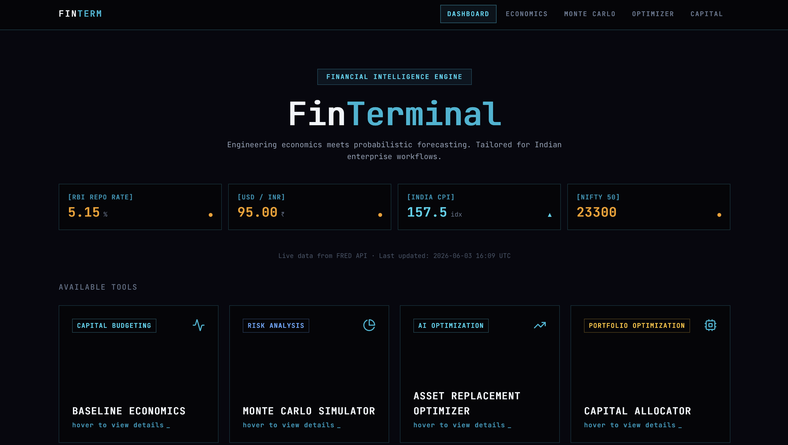
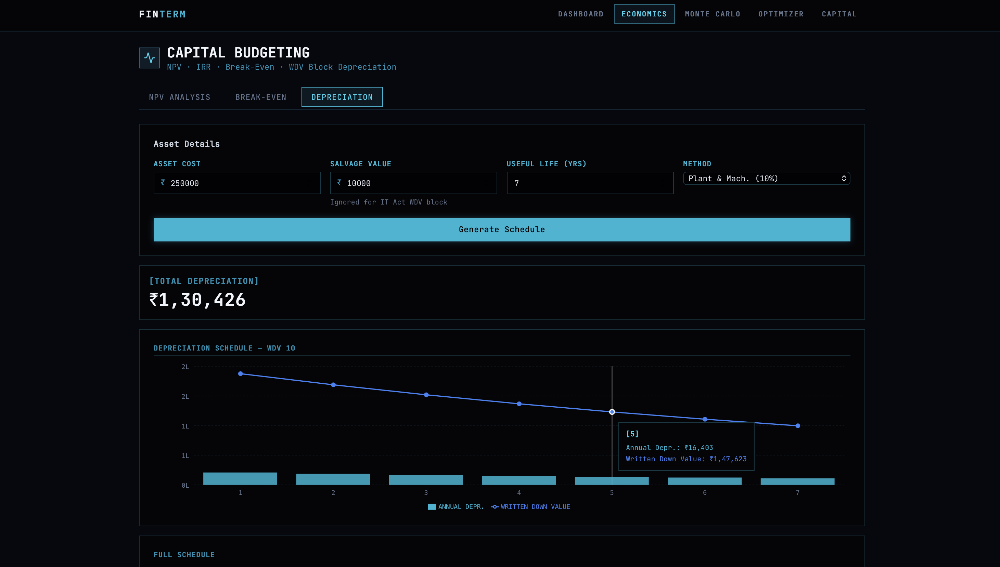
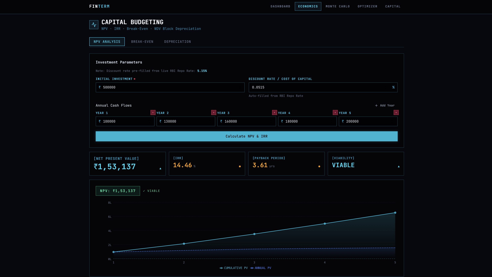
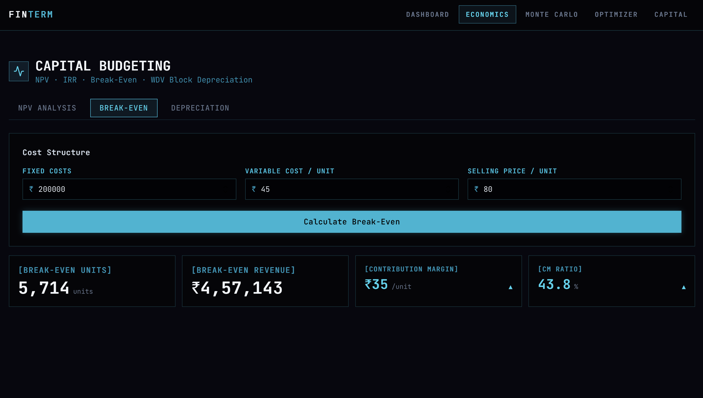
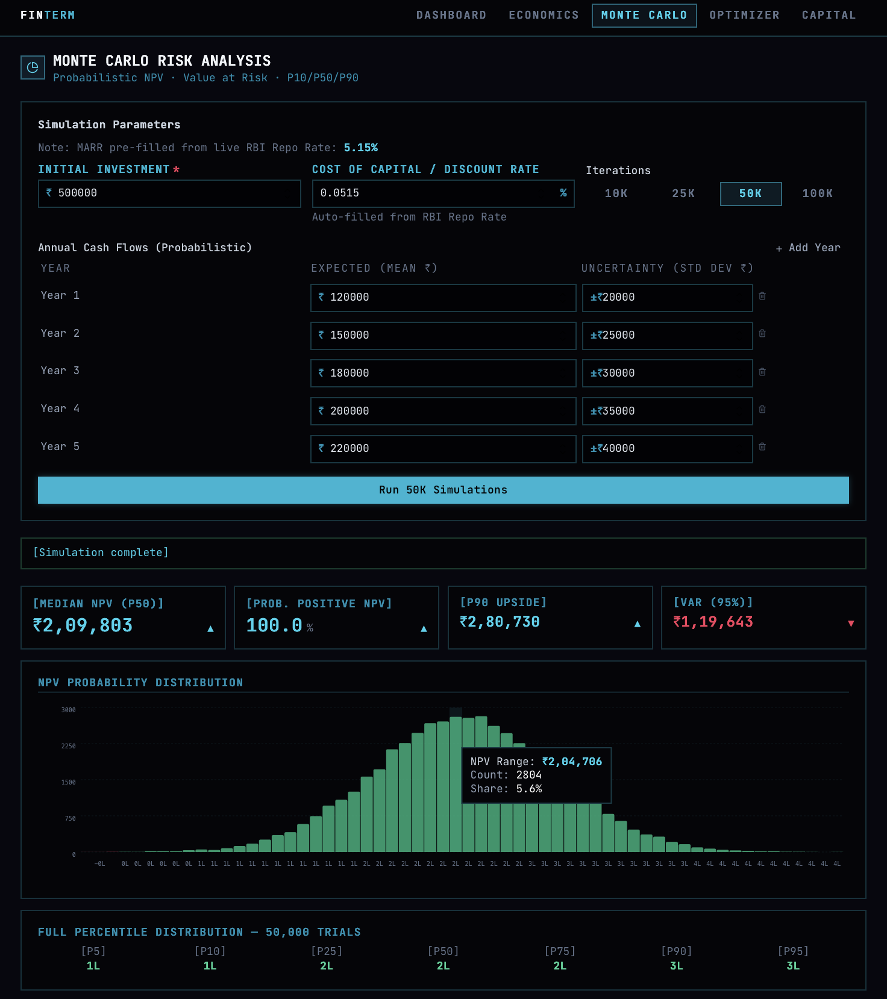
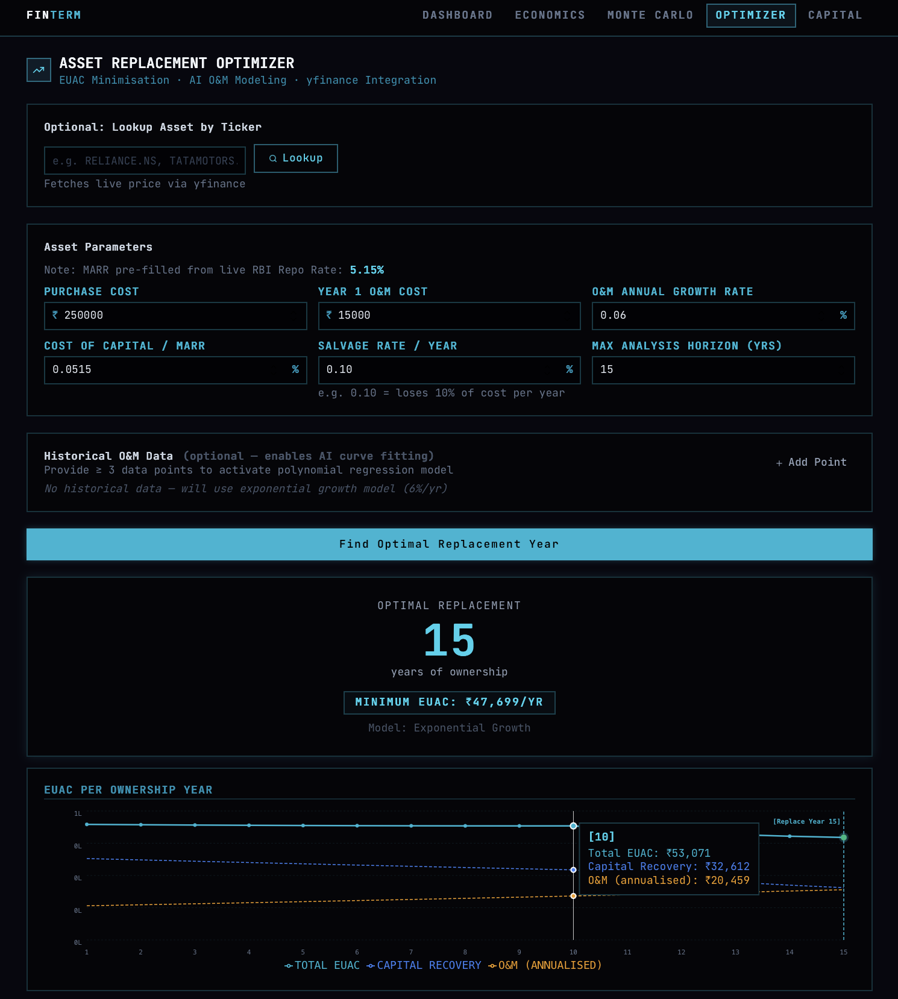
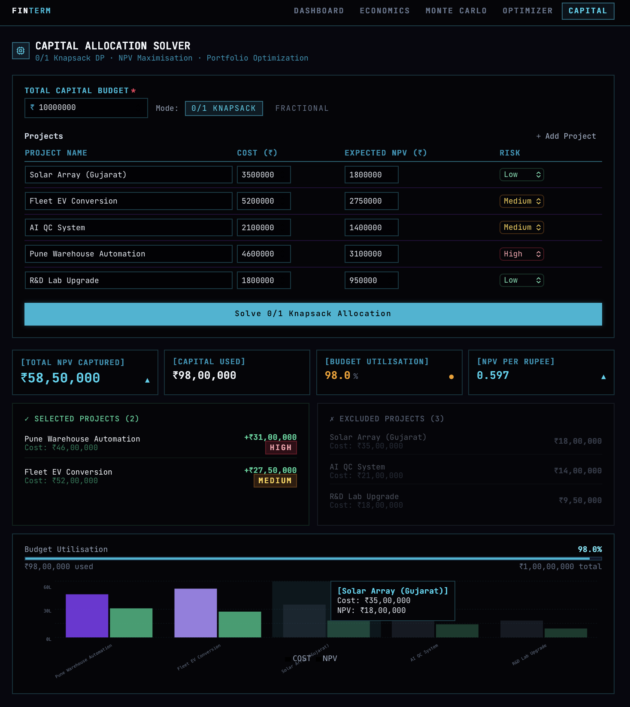

# Financial Terminal

This is a real-time financial intelligence engine tailored for Indian enterprise workflows. It combines classical engineering economics with probabilistic forecasting, AI-powered optimization, and dynamic capital allocation. 

I designed it to operate securely and efficiently at zero-cost via an AWS Serverless architecture, offloading heavy mathematical computations to dedicated asynchronous AWS Lambda functions.

---

## Live Demo
Access the live application: [FinTerminal](https://fintech-engine-frontend-vk-2026.s3.ap-south-1.amazonaws.com/index.html)

---

## Dashboard Overview
The dashboard provides a high-level view of current Indian macro rates fetched live from the FRED API and Yahoo Finance.



---

## Core Features

### 1. Baseline Economics (Capital Budgeting)
Computes time-value-adjusted Net Present Value (NPV), Internal Rate of Return (IRR), and Payback Periods. It also generates exact Written Down Value (WDV) block depreciation schedules in compliance with the Indian Income Tax Act.





### 2. Monte Carlo Risk Simulator
Quantifies investment risk by running up to 100,000 probabilistic NPV simulations. Outputs the exact distribution of possible financial outcomes and determines the 95% Confidence Value at Risk (VaR).



### 3. Asset Replacement Optimizer (AI-Powered)
Utilizes polynomial regression (Machine Learning) to curve-fit historical Operations & Maintenance (O&M) cost escalations. It calculates the exact ownership horizon to minimize Equivalent Uniform Annual Cost (EUAC) and fetches live market data to inform capital expenditure metrics.



### 4. Capital Allocator
Solves the classic 0/1 Knapsack Problem using dynamic programming. Algorithmically selects the exact optimal combination of financial projects that maximizes total Portfolio NPV without exceeding a fixed capital budget constraint.



---

## Architecture & Tech Stack

This project operates using a highly-scalable, 100% serverless architecture to ensure zero ongoing infrastructure costs (bypassing persistent EC2 charges) while safely co-existing with existing AWS Honeypot instances.

### Frontend
- Framework: React 18 + Vite
- Language: TypeScript
- Styling: Tailwind CSS (Vanilla CSS core), Framer Motion (micro-animations)
- Deployment: AWS S3 Static Website Hosting (HashRouter enabled to support direct client-side deep linking without 404s).

### Backend
- Framework: FastAPI
- Language: Python 3.11
- API Engine: AWS API Gateway + AWS Lambda (FintechApiFunction)
- Compute Layer: Compute-heavy mathematical routes (Monte Carlo, Optimization, Knapsack) are offloaded to dedicated Lambda microservices using aiobotocore asynchronously to bypass API Gateway timeouts.
- Data Integrations: Live integration with FRED API (Federal Reserve Economic Data) for RBI Repo Rates and Indian CPI, and Yahoo Finance for Nifty 50 and custom stock tickers. Features graceful failover mechanisms to realistic static baselines if API rate-limits are hit.
- Deployment: AWS Serverless Application Model (AWS SAM).

---

## Local Development

### 1. Backend (FastAPI)
Navigate to the backend directory and set up the Python environment:
```bash
cd backend
python3 -m venv venv
source venv/bin/activate
pip install -r requirements.txt
```

Ensure your `.env` file is populated with valid keys:
```env
FRED_API_KEY=your_key
AWS_ACCESS_KEY_ID=your_aws_key
AWS_SECRET_ACCESS_KEY=your_aws_secret
AWS_DEFAULT_REGION=ap-south-1
LAMBDA_MONTE_CARLO=fintech-monte-carlo
LAMBDA_OPTIMIZER=fintech-optimizer
LAMBDA_CAPITAL_SOLVER=fintech-capital-solver
```
Run the local dev server:
```bash
uvicorn app.main:app --reload --port 8001
```

### 2. Frontend (React)
Navigate to the frontend directory:
```bash
cd frontend
npm install
```
Ensure your `.env` file points to the local backend:
```env
VITE_API_BASE_URL=http://localhost:8001
```
Run the local Vite server:
```bash
npm run dev
```

---

## Deployment Instructions

### Backend Deployment (AWS SAM)
The backend is bundled and deployed via AWS SAM to CloudFormation.
```bash
cd backend
rm -rf lambda_build/app 
cp -r app lambda_build/app 
cd lambda_build 
zip -q -r ../lambda_function.zip . 
cd .. 
sam deploy --template-file template.yaml --stack-name fintech-api --resolve-s3 --capabilities CAPABILITY_IAM
```

### Frontend Deployment (AWS S3)
The React application is built via Vite and pushed directly to the S3 Bucket using the custom Python deployment script.
```bash
cd frontend
npm run build
../backend/venv/bin/python deploy_s3.py
```

---

## Security & Existing Infrastructure Note
This application was explicitly designed to be completely serverless and event-driven to avoid interacting with or consuming resources from the existing advanced live API Honeypot EC2 infrastructure hosted on the same AWS account. All APIs utilize stateless temporary IAM execution roles.
